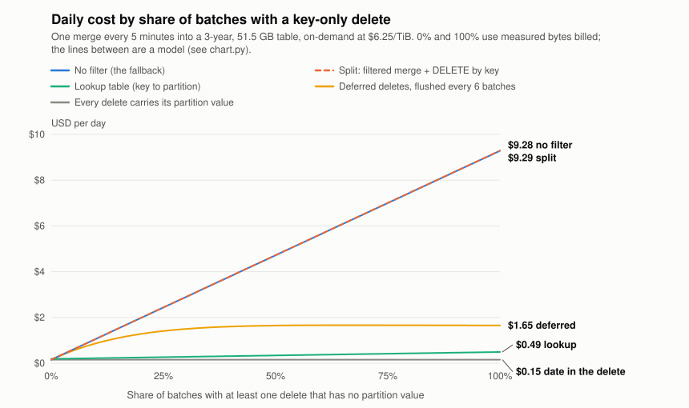

# BigQuery CDC merges: what to do when a delete has no partition value

Follow-up tests to Artie's open benchmark, [BigQuery MERGE partition pruning](https://www.artie.com/blogs/bigquery-partition-aware-cdc-merges) ([harness](https://github.com/artie-labs/benchmarks/tree/master/bigquery-merge-partition), MIT). `run.sh` and `LICENSE-artie-benchmarks` are Artie's, unchanged. Everything else here is new. No affiliation with Artie.

Measured on BigQuery on 2026-11-15. Region `US`, on-demand pricing, one run. Every number comes from a file in `results/`. Dollars are bytes billed × 288 merges a day × $6.25/TiB.

## The short version

**The problem.** Artie's benchmark shows a filter that makes a BigQuery merge read only the days a batch touches. It cuts the cost from $9.28 to $0.15 a day. The filter is built from the dates in the batch. A Postgres delete, on default settings, carries only the row's key and no date. One such delete in a batch, and the batch has to read the whole table again. Artie's post says so: "Deletes are the one to check."

**What I measured.** What that costs, and four ways to handle it.

| Way to handle a batch with key-only deletes | USD/day | Verdict |
|---|---|---|
| Fall back to the merge without the filter | 9.28 | Fine when it is rare. One batch costs 3 cents. |
| Filtered merge, plus a separate `DELETE` by key | 9.29 | No saving. Rejected. |
| Look the date up in a key-to-date table in BigQuery | 0.49 | Cheap here. Does not scale. Not recommended. |
| Queue the deletes, apply them every 6th batch | 1.65 | Recommended. The flush interval sets the bill. |

**What I recommend.** Pick the strategy per table, from how its deletes behave.

| The table's deletes | Strategy |
|---|---|
| Carry the date, or there are none | Filter only. Nothing extra. |
| Key-only, and rare | Let that batch fall back. 3 cents each. |
| Key-only, and regular | Queue them. Flush on a schedule. 3 cents per flush. |
| The source database can change | `REPLICA IDENTITY USING INDEX`, so every delete carries the date. |



## Where to look

| To see | Open |
|---|---|
| The four strategies as SQL | `ext.sh`: `arm_a`, `arm_s`, `arm_l`, `arm_d` (about 45 lines) |
| The batch with key-only deletes | `ext.sh`: `pk_batch` |
| Bytes, dry-run estimate and cost per statement | `results/xsummary.csv` |
| Every job, with labels and row counts | `results/xops.csv` |
| The check that all four end with the same table | `results/xverify.csv` |
| What Postgres sends under each setting | `pg_identity.sh`, section 6 |

## 1. Setup and reproduction

Artie's table and batch, built by their harness:

- Table `activity(uuid, created_at, status, payload JSON)`, partitioned by `DATE(created_at)`.
- 1,095 daily partitions, 109.5M rows, 51.5 GB.
- One batch: 300 inserts, 150 updates, 50 deletes, over two partitions.

Their head-to-head step, rerun (`results/summary.csv`, 5 runs per arm):

| Arm | GB billed | USD/day | Artie's published |
|---|---|---|---|
| No filter | 5.669 | 9.28 | 5.67 GB, $9.28 |
| Filter | 0.094 | 0.15 | 94 MB, $0.16 |
| No filter, table clustered by `uuid` | 3.818 | 6.25 | 3.82 GB |

Bytes match. Slot time did not: 191 s here without the filter, 98 s in theirs. Their post warns that slot time swings between runs. I compare bytes only.

## 2. Deletes that carry only the key

Each batch had 50 deletes with no `created_at`. Twelve batches in a row, per strategy (`seq_recent` in `results/xsummary.csv`).

| Strategy | Mean GB billed per batch | USD/day | Slot seconds, median (range) |
|---|---|---|---|
| `a` no filter | 5.670 | 9.28 | 111 (85–571) |
| `s` split | 5.675 | 9.29 | 99 (79–176) |
| `l` lookup | 0.299 | 0.49 | 167 (143–248) |
| `d` deferred, flush every 6 | 1.007 | 1.65 | 3 (2–267) |

All four ended with the same table: 109,503,000 rows, same key fingerprint, same partition layout, same full-row fingerprint on the two partitions the batches touched (`results/xverify.csv`). That is one 12-batch run. It is a check, not a proof for every case.

### Why split saves nothing

- The `DELETE` by key has no partition filter either.
- It billed 5.627 GB. The unfiltered merge billed 5.670 GB.
- The filtered merge beside it was only 0.048 GB.
- So you pay the full read anyway, just in a second statement.

### Why I do not recommend the lookup table

It was the cheapest in this test. These are the reasons not to build on it.

- **Cost grows with deletes.** 50 deletes read about 50 of 3,000 hash buckets. More deletes read more buckets. With thousands of deletes per batch it would read most of the lookup table, twice.
- **Old deletes cost much more.** With the 50 deletes spread over 50 old days, it billed 2.604 GB a batch, not 0.299 (`del_spread`). The merge pays for every partition it changes.
- **It can lose a delete.** The lookup stores the date a row was inserted with. If a row's `created_at` changes later, the lookup points at the wrong day and the delete is skipped. Not tested here.
- **Part of it was never exercised.** The test only deleted original rows. No batch deleted a row that an earlier batch had inserted. So the "add new keys" step was billed but not proven.
- **More work per batch.** Four statements, not one: resolve 0.092 GB, lookup delete 0.092, merge 0.095, lookup insert 0.021.
- **More slot time than no filter.** 167 s against 111 s. On capacity pricing it may cost more, not less.
- **It needs building.** The one-off build billed 4.6 GB.

### Why I recommend the queue

- **A flush costs the same whatever is waiting.** It billed 5.627 GB with 50 deletes queued and 5.627 GB with 300.
- **So the flush interval sets the bill.** At $6.25/TiB one flush is 3 cents. Every 6th batch gave $1.65 a day. Fewer flushes cost less.
- **Between flushes the merge is cheap.** 0.048 GB for the merge, 0.021 GB to queue the deletes.
- **It is one extra table and one extra statement.**

What it does not solve yet:

- **Readers see deleted rows until the flush.** A view that hides queued keys would fix that. Not built or measured here.
- **The data is still stored until the flush.** That matters for erasure requests.
- **Delete, then insert the same key again, inside one flush window.** The flush would delete the new row. It needs an ordering column. Not tested here.
- **Old deletes cost more per flush.** A flush also pays for each partition it changes.

Flush intervals other than every 6th batch are not measured yet.

## 3. Rows that move to another partition

100 rows from yesterday get `created_at` moved one day later (`results/xmoves.csv`).

| Filter built from | Rows in the two days | Duplicate keys | GB billed |
|---|---|---|---|
| Nothing (no filter) | 200,000 | 0 | 5.627 |
| The new date only | 200,100 | 100 | 0.021 |
| The old and the new date | 200,000 | 0 | 0.052 |

- With only the new date, the merge never looks in the old partition.
- It finds no match there, so it inserts a second copy.
- With both dates, the result equals the unfiltered merge, at a hundredth of the bytes.
- The old date reaches a CDC reader only if the replica identity includes `created_at`.

## 4. The same batch, with and without the filter

About 500 updates spread evenly over n partitions. Both arms merge the same staged batch into a fresh clone. 3 runs each.

| Partitions touched | No filter, GB billed | Filter, GB billed |
|---|---|---|
| 30 | 6.842 | 1.410 |
| 120 | 10.614 | 5.640 |
| 365 | 20.816 | 17.093 |

BigQuery bills a merge as the columns it reads in every partition scanned, plus the full size of every partition it changes ([DML pricing](https://docs.cloud.google.com/bigquery/docs/reference/standard-sql/dml-syntax)). Both arms pay for the changed partitions.

## 5. Dry runs

Every measured statement was dry-run first (`results/xdryrun.csv`).

- **Filtered merges:** the estimate matched the bill (0.98 to 1.00 of bytes billed). The two filtered merges in section 3 were the exception, at 1.8× and 2.2×.
- **Unfiltered merges and deletes:** the estimate was always the whole table, 51.465 GB. The bill was 5.6 to 20.8 GB.

A dry run prices the filtered merge well. It cannot price the unfiltered one.

## 6. Fixing it at the source: Postgres replica identity

`pg_identity.sh`, Postgres 17.12 in Docker, one run per row width.

What a CDC reader receives (`test_decoding` output, printed by the script):

| Identity | A delete carries | An update that changes `created_at` carries |
|---|---|---|
| DEFAULT | `uuid` only | new row only |
| USING INDEX (uuid, created_at) | `uuid`, `created_at` | old `uuid, created_at` + new row |
| FULL | whole old row | whole old row + new row |

So `USING INDEX` puts the date in every delete. Every batch can then use the filter.

WAL bytes per row (`results/ri_400.csv`, `results/ri_4000.csv`):

| Row payload | Phase | DEFAULT | USING INDEX | FULL |
|---|---|---|---|---|
| 400 B | insert | 694 | 842 | 694 |
| 400 B | update | 1,556 | 1,982 | 2,061 |
| 400 B | delete | 632 | 648 | 1,106 |
| 4,000 B (TOASTed) | insert | 4,728 | 4,882 | 4,728 |
| 4,000 B (TOASTed) | update | 9,522 | 9,949 | 13,638 |
| 4,000 B (TOASTed) | delete | 4,571 | 4,587 | 8,655 |

Read these with care:

- **The baseline is inflated.** The script runs `CHECKPOINT` before each phase. The first change to each page then logs the whole page. So the gap between settings is probably wider in steady use than this table shows.
- **Narrow rows:** the extra index costs about as much WAL on updates as FULL, and adds to inserts.
- **Wide rows:** USING INDEX is far cheaper than FULL on updates and deletes.

Costs of this fix that the table does not show:

- It is a new unique index on the customer's busiest table.
- `created_at` must be `NOT NULL`.
- If someone drops the index, updates and deletes on the source start to fail.
- Changes written before the switch are still key-only, so a fallback is still needed.

Cases where no fix is needed:

- A source table already partitioned by `created_at`. Its primary key must include that column, so deletes already carry it.
- A source that already sends the full old row.

## Run it

```sh
gcloud auth login
PROJECT=<project> ./ext.sh xsetup h2h report   # reproduce Artie's head-to-head
PROJECT=<project> ./ext.sh xkeymap xdeletes xmoves xspread xsequence xverify xadvisor xreport
python3 chart.py
PROJECT=<project> ./ext.sh cleanup
```

- Needs bash 4+ (`brew install bash` on macOS) and a project with billing on. The BigQuery sandbox has no DML.
- The whole run billed about 0.5 TB. That is inside the 1 TiB monthly free tier if nothing else used it.
- A custom `QueryUsagePerDay` quota is a real cap. A budget only sends email.
- `pg_identity.sh` needs Postgres 14+ with `wal_level=logical`. The Docker command is in the file.

## Limits

- Synthetic data. One table, one schema, one region, one run.
- On-demand pricing only. Slot time is reported, not priced.
- Every batch had exactly 50 key-only deletes. The lookup and queue costs depend on that number.
- The 12-batch sequence used deletes of recent rows only.
- Bytes billed were the same on every repeat. Slot time was not.
- The chart's two ends are measured. The lines between are a model: each batch either has a key-only delete or not, independently. Real tables are likely near one end.
- Not tested: larger tables, thousands of deletes per batch, clustered tables with these strategies, hourly or monthly partitions, sources other than Postgres.
